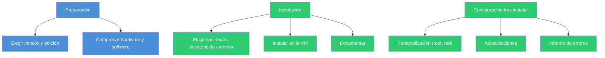

# Tema 4. Instalación y explotación básica de SO de servidores libres

En este curso instalaremos **Ubuntu Server 26.04 LTS**, la versión con soporte vigente (ver nota en el punto 2.1). Es la continuación directa del Tema 3: mismo bloque ("Instalación y explotación básica de servidores"), pero con el SO **libre** en vez del propietario.

---

## Índice

1. [Introducción y contextualización práctica](#1-introducción-y-contextualización-práctica)
2. [Preparación de la instalación](#2-preparación-de-la-instalación)
3. [Caso práctico 1: "Clonaciones en red"](#3-caso-práctico-1-clonaciones-en-red)
4. [Instalación local del sistema operativo](#4-instalación-local-del-sistema-operativo)
5. [Instalación desatendida del sistema operativo](#5-instalación-desatendida-del-sistema-operativo)
6. [Instalación remota del sistema operativo](#6-instalación-remota-del-sistema-operativo)
7. [Configuración tras la instalación](#7-configuración-tras-la-instalación)
8. [Actualizaciones del servidor y cambio de versión](#8-actualizaciones-del-servidor-y-cambio-de-versión)
9. [Caso práctico 2: "Instalación de Ubuntu 22.04"](#9-caso-práctico-2-instalación-de-ubuntu-2204)
10. [Problemas durante la instalación](#10-problemas-durante-la-instalación)
11. [Documentación de la instalación](#11-documentación-de-la-instalación)
12. [Resumen y resolución del caso práctico de la unidad](#12-resumen-y-resolución-del-caso-práctico-de-la-unidad)
13. [Bibliografía](#13-bibliografía)

---

## 1. Introducción y contextualización práctica

Cada vez hay más servidores que usan sistemas operativos **libres** (código abierto, normalmente gratuitos). Hace falta conocer:

- Cómo se instalan (varias formas posibles).
- Cómo se configuran y personalizan tras la instalación.
- Cómo gestionar actualizaciones e incidencias.

---

## 2. Preparación de la instalación

Elegimos **Ubuntu**, distribución Linux basada en Debian GNU/Linux, por ser:

- Orientada al usuario final (intuitiva).
- La distribución más utilizada.


### 2.1. Versiones del sistema operativo

Ubuntu se lanza cada 6 meses (**abril** y **octubre**). El número de versión es **año.mes**; cada versión tiene también un nombre de dos palabras (animal + adjetivo) que empiezan por la misma letra.

| Lanzamiento | Versión | Tipo de soporte |
|---|---|---|
| Abril 2018 | 18.04 LTS Bionic Beaver | 5 años |
| Abril 2022 | 22.04 LTS Jammy Jellyfish | 5 años (versión del libro) |
| Abril 2024 | 24.04 LTS Noble Numbat | 5 años |
| **Abril 2026** | **26.04 LTS** | **5 años (hasta 2031) — la que usaremos en este curso** |

- **LTS** ("Long Term Support"): sale cada **2 años**, soporte de **5 años** con actualizaciones de seguridad.
- Versión **no-LTS**: soporte de solo **9 meses**.

> ✅ **En este curso:** instalaremos **Ubuntu Server 26.04 LTS**, por ser la LTS vigente con soporte más largo.

### 2.2. Requisitos de software y hardware

Los requisitos de la **edición de escritorio** de Ubuntu 22.04 (mínimos):

| Recurso | Mínimo (escritorio) |
|---|---|
| Procesador | Doble núcleo, 2 GHz |
| RAM | 4 GB |
| Disco | 25 GB |
| Otros | Unidad CD/DVD o USB, acceso a Internet, teclado y ratón |

> 💡 Para nuestra práctica (**Ubuntu *Server*** en VirtualBox, sin entorno gráfico) basta con mucho menos: 1 CPU, **1-2 GB de RAM** y **10-20 GB de disco** son suficientes para probar en una VM.

### 2.3. Particiones y sistema de archivos

En Linux es habitual plantear (como mínimo) tres particiones:

| Partición | Para qué sirve |
|---|---|
| `swap` | Intercambio de memoria / paginación cuando falta RAM |
| `/` (raíz, "system") | Aquí se instala el sistema; es el directorio raíz de todo el árbol |
| `/home` | Datos y configuración de cada usuario |

- Cada partición necesita un **sistema de archivos**: en Linux hay varios (ext2, ext3, ext4, ReiserFS...). El más usado en versiones recientes es **ext4**.
- Las particiones se representan como **puntos de montaje** dentro del árbol de directorios (no como letras, a diferencia de Windows: no hay `C:`, `D:`...; todo cuelga de `/`).


### 2.4. Componentes

Una distribución GNU/Linux se compone, principalmente, de:

- El **núcleo** (*kernel* Linux).
- Los **programas** y herramientas de administración de archivos.
- La **gestión de usuarios**.
- Los **gestores de paquetes** (con los que se instala/actualiza/desinstala software).

---


## 3. Instalación local del sistema operativo

### 3.1. Creación de la máquina virtual

Pasos con **VirtualBox** (software libre de virtualización):

1. **Nueva** → nombre, carpeta, tipo y versión de SO.
2. **RAM**: con 2 GB es suficiente (para Ubuntu Desktop del libro; para Ubuntu *Server* basta con 1-2 GB).
3. **Disco duro virtual**: se recomienda **10 GB**, tipo **VDI**, tamaño **dinámico** (reservado según uso real, no de golpe).
4. Al terminar, la VM aparece en el panel izquierdo con un resumen (sistema, pantalla, almacenamiento, audio, red).

### 3.2. Instalación del sistema operativo en la máquina virtual

Pasos generales del asistente:

1. Descargar la ISO de la versión elegida.
2. **Almacenamiento** de la VM → controlador IDE/SATA → añadir el `.iso`.
3. Arrancar la VM → elegir modo de instalación.
4. Elegir idioma → "Instalar".
5. Tipo de instalación (normal/mínima) y si se descargan actualizaciones durante la instalación.
6. Tipo de instalación de disco: si no detecta otro SO, se ofrece borrar el disco e instalar Ubuntu (instalación guiada) — o personalizar el particionado.
7. Localización (zona horaria): Madrid.
8. Nombre, nombre del equipo, usuario y contraseña.
9. Instalación (varios minutos).
10. Reinicio.
11. Login con el usuario creado.
12. Escritorio/consola lista para usar.


---

## 4. Instalación desatendida del sistema operativo

Para instalar en **muchos equipos** sin intervención manual, se usa un **archivo de respuestas** (en Ubuntu, el instalador moderno lo llama *autoinstall*, en formato `cloud-init`/YAML).

Pasos típicos:

1. Arranque por red con **PXE** (se evita usar USB/DVD).
2. El equipo pide al servidor la ubicación del archivo de respuestas.
3. El instalador descarga ese archivo.
4. Comienza la instalación automática según lo indicado en el archivo (de dónde sacar los paquetes, particiones, usuario, etc.).
5. Al terminar, el equipo se reinicia.

> 💡 **Kickstart** es otra herramienta (más típica del mundo Red Hat/CentOS) para lo mismo: centralizar y reutilizar la configuración de instalación en red.

---

## 5. Instalación remota del sistema operativo

Instalación **en red**: usando un recurso compartido en red, o bien **instalación remota** propiamente (instalar el SO de un equipo *desde otro equipo* de la red). Para hacerlo bien hace falta conocer lo siguiente:

### 5.1. Descarga de software y paquetes de instalación

- Por **línea de comandos**: gestores como `dselect`, o los habituales `dpkg`/`apt`.
- Por **interfaz gráfica**: el Centro de Software de Ubuntu (si hay entorno gráfico instalado).

### 5.2. Tipos de archivos comprimidos

| Extensión | Comando típico |
|---|---|
| `.zip` | `unzip nombre.zip` |
| `.gz` | `gzip -d nombre.gz` (o `gunzip`) |
| `.tar` | `tar xvzf nombre.tar` (x=extraer, f=fichero) |
| `.rar` | `-x` (similar a WinRAR) |

### 5.3. Herramientas de descarga e instalación

- **Centro de Software de Ubuntu**: buscar/instalar/actualizar/desinstalar, en modo gráfico.
- **GNOME Software**: trabaja junto al gestor de paquetes **Synaptic**.

### 5.4. Desinstalaciones

- **Gráfica**: Synaptic → seleccionar el paquete → "Marcar para desinstalar completamente".
- **Por comandos**: `sudo apt purge <paquete>` y después `sudo apt autoremove` (elimina dependencias que ya no usa nadie).

---

## 6. Configuración tras la instalación

### 6.1. Personalización del entorno servidor

Configuraciones básicas recomendadas tras instalar:

| Tarea | Qué implica |
|---|---|
| **Usuario root** | Deshabilitado por defecto en Ubuntu (seguridad). Se gestiona con `sudo` o se habilita con `passwd root` |
| **Configuración de red** | Nombre del servidor e IP — se puede fijar en la instalación o después |
| **Actualizaciones** | Mantener el sistema al día (ver punto 8) |
| **Firewall** | Revisar/activar `ufw` si procede |
| **Servicios remotos** | SSH, para poder administrar el servidor sin estar delante |

> 💡 Por defecto, **Ubuntu Server no tiene interfaz gráfica** (es la gran diferencia respecto al Ubuntu Desktop): se administra todo desde la terminal, en modo texto. Si se quisiera instalar un entorno gráfico (no es lo habitual en un servidor real), se podría con algo como `sudo apt install gnome-shell ubuntu-gnome-desktop -y` y reiniciando después. **No lo haremos en la práctica**: un servidor sin GUI consume menos recursos y reduce la superficie de ataque.

### 6.2. Terminal

Aunque hubiera entorno gráfico, en Linux se trabaja mucho por **terminal** (rapidez, se automatiza fácil, y es la única vía en un servidor sin GUI).

| Comando | Qué hace |
|---|---|
| `help` | Ayuda breve de un comando |
| `man` / `info` | Manual completo (dos formatos distintos) |
| `apropos` | Busca una palabra dentro de los manuales |
| `whatis` | Explicación breve de un comando |
| `exit` | Cierra la sesión/terminal |
| `date` | Fecha y hora del sistema |
| `cal` | Calendario (mes actual, o uno indicado) |
| `passwd` | Cambia la contraseña de un usuario |
| `history` | Historial de comandos ejecutados |
| `who` | Qué usuario(s) están conectados |
| `w` | Usuario conectado + qué está haciendo |
| `clear` | Limpia la pantalla |
| `alias` | Asigna un nombre corto a un comando (o cadena de comandos) |
| `shutdown` | Apaga o reinicia el equipo |
| `sudo` | Ejecuta un comando con privilegios de administrador |
| `cat` | Muestra el contenido de un fichero |
| `head` | Muestra las 10 primeras líneas de un fichero |
| `more` | Muestra un fichero paginado |
| `cd` | Cambia de directorio |
| `file` | Indica el tipo de un fichero |

---

## 7. Actualizaciones del servidor y cambio de versión

Dos tipos de actualización:

| Tipo | Qué cambia |
|---|---|
| **Calidad y seguridad / nuevas versiones de paquetes** | Mantiene el SO y los programas al día **sin cambiar de versión** de Ubuntu |
| **Cambio de versión** | Pasar a una versión de Ubuntu nueva (cada 6 meses sale una; las LTS, cada 2 años, con soporte de 5 años) |

Comprobar y aplicar actualizaciones de paquetes, por terminal:

```bash
sudo apt update && sudo apt upgrade && sudo apt dist-upgrade
```

### 7.1. Repositorios y servidores de actualización

| Comando | Qué hace |
|---|---|
| `sudo apt update` | Actualiza la **lista** de paquetes disponibles en los repositorios (no instala nada todavía) |
| `sudo apt upgrade` | **Descarga e instala** las versiones más recientes de los paquetes ya instalados |

> ⚠️ Son dos pasos distintos y en ese orden: primero actualizar la lista (`update`), después aplicar las actualizaciones (`upgrade`). Ejecutar solo `upgrade` sin haber hecho antes `update` puede dejar paquetes desactualizados sin que el sistema lo sepa.

### 7.2. Servidores proxy

Un **proxy** filtra y gestiona las peticiones de salida a Internet (el navegador, o cualquier programa, pide la página/recurso al proxy, y este decide si se permite el acceso). Linux se puede configurar para salir a Internet a través de uno.

---

## 8. Problemas durante la instalación

| Problema | Posible causa / solución |
|---|---|
| Error en la **tabla de particiones** | No se reconocen las particiones existentes → hay que formatear |
| "No se encuentran los dispositivos" | Hardware no compatible → buscar/instalar controladores, o consultar con el fabricante |
| Problemas con la **tarjeta gráfica** | El modo gráfico no es compatible → instalar en **modo texto** (es justo lo que hace Ubuntu Server por defecto) |

### 8.1. Informe de errores

- Ruta gráfica: `Configuración → Privacidad → Diagnósticos` (manual, automático o nunca).
- Por comando: `ubuntu-bug`.

---

## 9. Documentación de la instalación

Como ya vimos en el Tema 3 (Windows), hay que documentar el proceso. En Ubuntu, anotar al menos:

- ✅ Hardware del equipo.
- ✅ Controladores instalados.
- ✅ Particiones creadas.
- ✅ Opciones de instalación elegidas.
- ✅ Usuarios creados.

> 💡 Linux **no tiene un centro de soporte oficial** como Microsoft: ante un problema, la referencia son los foros de la comunidad y la documentación oficial. Por eso conviene llevar un **cuaderno de bitácora** (documento con cada incidencia: motivo + solución), a ser posible con una plantilla fija para que todas las entradas tengan el mismo formato.

---

## 10. Resumen y resolución del caso práctico de la unidad



**Resolución del caso:** ¿es buena idea usar un SO libre como Ubuntu Server para aprender a administrar sistemas en red? Sí: es **gratuito** (facilita adquisición y actualización) y **flexible** (terminal + opción de entorno gráfico si se necesitara).

---

## 🎯 Lo esencial del tema

- Ubuntu es una distribución Linux (basada en Debian) orientada a usuario final, con versión **LTS** (soporte 5 años) cada 2 años, y versiones intermedias con 9 meses de soporte.
- En Linux, lo habitual es pensar en **particiones por función**: `/` (sistema), `swap` (intercambio), `/home` (datos de usuario) — el sistema de archivos típico es **ext4**.
- Hay tres formas de instalar: **local** (atendida, con DVD/USB o ISO), **desatendida** (archivo de respuestas + PXE o Kickstart) y **remota** (desde otro equipo de la red).
- Tras instalar, hay que: habilitar/gestionar el usuario root, configurar red, actualizar (`apt update` / `apt upgrade`), y documentar todo el proceso.
- La administración del día a día se hace sobre todo por **terminal** (SSH incluido): no hay centro de soporte oficial como en Windows, así que la comunidad y la documentación son la principal fuente de ayuda.

---


