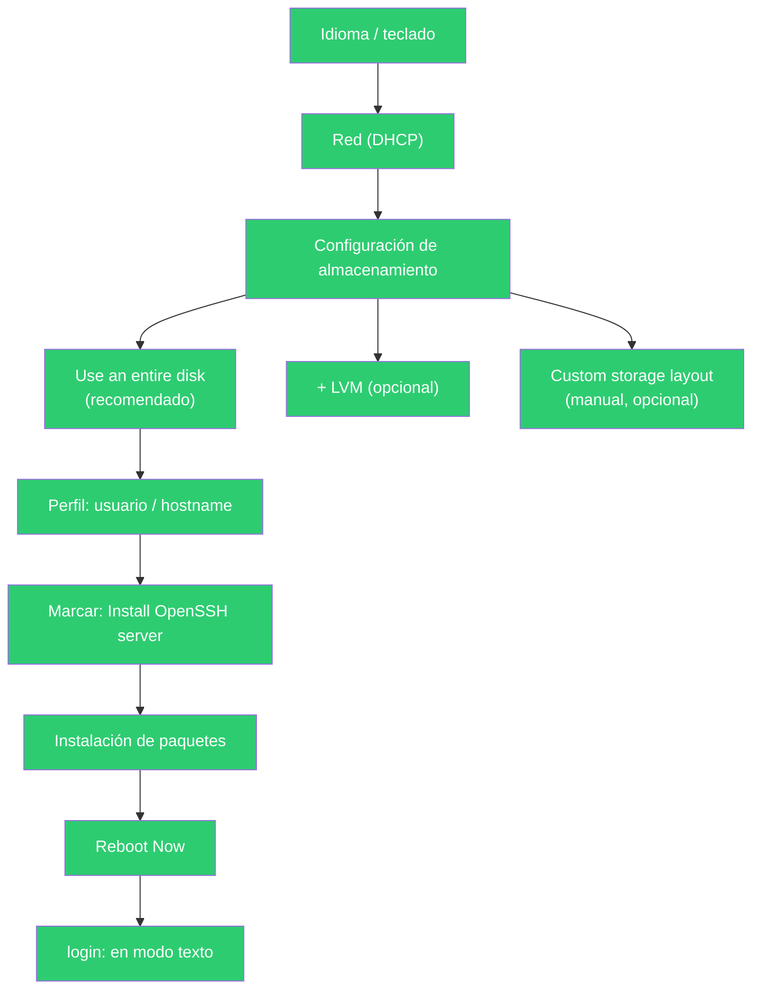

# Casos Prácticos — Tema 4. Instalación y explotación básica de SO de servidores libres

---

## Caso Práctico 1 — "Instalación de Ubuntu 26.04"

**Planteamiento:** repetir en limpio los pasos de instalación de Ubuntu, esta vez con la versión y edición que usaremos en el curso: **Ubuntu Server 26.04 LTS**, en una VM de VirtualBox.

**Nudo:** a diferencia del libro (que instala la edición Desktop, con interfaz gráfica), nuestro objetivo es un **servidor** real: sin entorno gráfico, administrado por terminal/SSH. El instalador también cambia de aspecto: Ubuntu Server usa un instalador en modo texto llamado **Subiquity**.

**Desenlace (resuelto, paso a paso):**

1. **Crear la VM** en VirtualBox: nombre, tipo "Linux", versión "Ubuntu (64-bit)", 1-2 GB de RAM, disco virtual VDI de 10-20 GB (dinámico).
2. **Montar la ISO** de Ubuntu Server 26.04 en el controlador de almacenamiento de la VM.
3. Arrancar la VM → aparece el instalador **Subiquity** (pantallas en modo texto, se navega con flechas/Tab/Intro, no con el ratón).
4. **Idioma** → español o inglés (indiferente para la práctica).
5. **Teclado**: distribución española.
6. **Tipo de red**: por defecto detecta la tarjeta de red y pide **DHCP** automáticamente (no hace falta tocar nada aquí si solo queremos salir a Internet).
7. **Proxy**: se deja en blanco si no hay uno en la red.
8. **Espejo de Ubuntu (mirror)**: se deja el valor por defecto.
9. **Configuración del almacenamiento (la pantalla que más dudas suele dar):**
   - Opción **"Use an entire disk"** (usar todo el disco): el instalador se encarga de crear las particiones necesarias automáticamente y de forma segura. **Es la opción recomendada para esta práctica** si no se tiene experiencia previa con particionado en Linux.
   - Dentro de esa misma opción, se puede marcar (opcional) **"Set up this disk as an LVM group"**: así el sistema se instala sobre **LVM** (un "disco virtual" flexible que permite redimensionar particiones más adelante sin reinstalar). Es la opción por defecto en instalaciones reales de servidor, pero para la práctica puedes dejarlo sin marcar: con o sin LVM, el resultado funciona igual a efectos de los ejercicios de este tema.
   - Existe también **"Custom storage layout"**, para crear las particiones a mano (tamaño y punto de montaje de cada una). **No es necesario usarla en esta práctica** — es la opción equivalente al particionado manual que hicimos en Windows (Tema 2), pero en Linux. Si en algún momento quieres practicarla, el único cuidado real es que necesitas al menos una partición montada en `/` (el resto, como `/home` o `swap`, son opcionales si no las separas).
10. **Confirmar** el resumen de particiones (si salió un aviso de "esto borrará los datos del disco", es normal: es un disco virtual nuevo y vacío).
11. **Perfil**: nombre completo, nombre del servidor (*hostname*), nombre de usuario y contraseña.
12. **Importar clave SSH de Ubuntu/GitHub (opcional)**: se puede saltar ("Skip for now").
13. **Instalar OpenSSH Server**: aparece una casilla "Install OpenSSH server" — **marcarla**. Es imprescindible para poder conectarnos después por SSH sin tener que instalar nada a mayores.
14. **Paquetes destacados (snaps)**: se puede dejar todo sin marcar, no son necesarios para la práctica.
15. El instalador descarga/instala los paquetes (tarda unos minutos).
16. **"Install complete!"** → **Reboot Now**.
17. Al reiniciar, login en consola con el usuario creado.

> 💡 **Diferencia clave con el libro:** el libro, en su versión Desktop, termina viendo un escritorio gráfico. Nuestro Ubuntu Server termina en una **pantalla de login en modo texto** (`login:`). Es el comportamiento correcto para un servidor: sin interfaz gráfica, se ahorran recursos y se reduce la superficie de ataque, y es exactamente lo que el ejercicio evaluable de este tema (`ejercicios.md`) va a usar como punto de partida.



---

## Caso Práctico 2 — Comprobar qué particiones y filesystem tiene el servidor ya instalado

Una vez instalado el servidor (con la opción guiada "Use an entire disk"), es útil saber **qué se ha creado realmente**, aunque no lo hayamos decidido nosotros a mano:

```bash
# Ver las particiones y dónde están montadas
lsblk

# Ver el sistema de archivos de cada partición
df -hT

# Ver si el disco usa LVM (si marcaste esa opción)
sudo lvs
sudo vgs
```

| Comando | Qué muestra |
|---|---|
| `lsblk` | Árbol de discos/particiones y sus puntos de montaje |
| `df -hT` | Espacio usado/libre por partición, con el tipo de sistema de archivos (normalmente `ext4`) |
| `sudo lvs` / `sudo vgs` | Volúmenes lógicos / grupos de volúmenes, solo si se instaló con LVM |

> 💡 Aunque el instalador haya decidido las particiones por nosotros, siempre podemos **comprobar después** qué ha hecho, sin ningún riesgo (son solo comandos de lectura).
