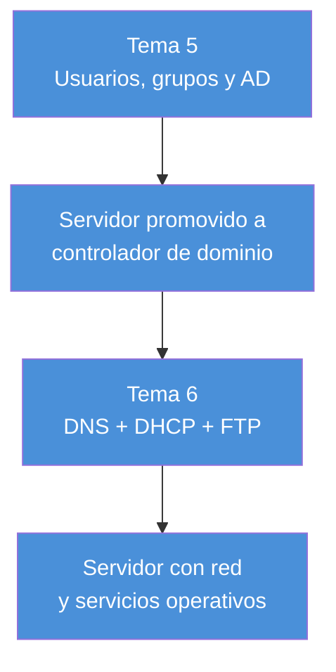

# Bloque 3 — Administración de sistemas operativos de servidor propietario

Usuarios, grupos y Active Directory en Windows Server, y los tres servicios de red fundamentales: DNS, DHCP y FTP.

| Tema | Título | Contenido |
|---|---|---|
| [Tema 5](tema05/) | Administración de SO de servidor propietario | Usuarios y grupos locales/de red, Active Directory (dominio, árbol, bosque, OU, Kerberos), perfiles de usuario, administración remota |
| [Tema 6](tema06/) | Administración de servicios fundamentales en SO de servidor propietarios | DNS (zonas, registros, jerarquía), DHCP (ámbitos, asignación de IPs), FTP (modos activo/pasivo, SFTP) |

## Estructura de cada tema

- **apuntes.md** — Resumen teórico/práctico, fiel a la numeración del libro.
- **casospracticos.md** — Casos prácticos del libro resueltos + un ejemplo propio adicional.
- **ejercicios.md** — Preguntas de clase (no evaluables) + ejercicio evaluable con rúbrica.

## Hilo conductor del bloque

El Tema 5 deja el servidor convertido en **controlador de dominio** (con DNS instalado como parte del proceso); el Tema 6 profundiza en ese DNS, añade DHCP para repartir IPs automáticamente, y cierra con FTP como servicio independiente de transferencia de archivos. Este bloque continúa en el [Bloque 4](../bloque4/README.md), donde se administra en profundidad ese dominio ya creado.
