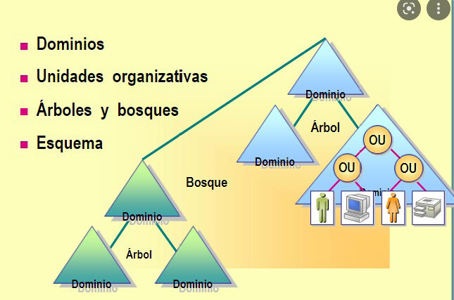

# Tema 5. Administración de SO de servidor propietario

---

## Índice

1. [Introducción y contextualización práctica](#1-introducción-y-contextualización-práctica)
2. [Configuración y gestión de usuarios y grupos locales](#2-configuración-y-gestión-de-usuarios-y-grupos-locales)
3. [Servicios de directorio](#3-servicios-de-directorio)
4. [Configuración y gestión de usuarios y grupos de red](#4-configuración-y-gestión-de-usuarios-y-grupos-de-red)
5. [Administración remota](#5-administración-remota)
6. [Resumen y resolución del caso práctico de la unidad](#6-resumen-y-resolución-del-caso-práctico-de-la-unidad)

---

## 1. Introducción y contextualización práctica

Una de las tareas más importantes de un administrador de sistemas es la **gestión de usuarios y grupos**. Hay dos tipos, según dónde se crean y hasta dónde llega su acceso:

- **Locales**: creados en un equipo concreto, solo válidos ahí.
- **De red**: para que un usuario acceda desde cualquier equipo de la red con los mismos permisos, se usa el **servicio de directorio** (Active Directory en Windows).

---

## 2. Configuración y gestión de usuarios y grupos locales

Un administrador de sistemas gestiona las **cuentas de usuario** y asigna permisos. Una cuenta de usuario permite:

- ✅ Autentica al usuario (comprueba que es quien dice ser).
- ✅ Limita el acceso solo a los recursos permitidos.
- ✅ Deja **registro** de las acciones (auditoría: quién hizo qué).

Para facilitar la gestión, los permisos no se dan usuario a usuario, sino a **grupos**: todo usuario del grupo hereda esos permisos.

### 2.1. Usuarios y grupos locales

| | Usuario/grupo local |
|---|---|
| Dónde se crea | En un equipo concreto (`Administración de equipos` → `Usuarios y grupos locales`) |
| Dónde es visible | Solo en ese equipo |
| Permisos de un usuario en varios grupos | Se **suman** todos los permisos de todos los grupos a los que pertenece |

### 2.2. Usuarios y grupos predeterminados y especiales

**Usuarios locales creados por defecto:**

| Usuario | Para qué |
|---|---|
| **Administrador** | Acceso total y permisos máximos: crea/gestiona usuarios y grupos, accede a cualquier archivo |
| **Invitado** | Acceso puntual sin cuenta propia. Sin contraseña. **Inactivo por defecto** (por seguridad) |

**Grupos locales predeterminados más usados:**

| Grupo | Para qué |
|---|---|
| **Administradores** | Acceso completo sin restricciones. No se puede eliminar. Por seguridad, debe tener el mínimo de miembros posible |
| **Operadores criptográficos** | Autorizados para operaciones criptográficas (transmitir datos de forma segura) |
| **Operadores de copia de seguridad** | Pueden hacer/restaurar copias de seguridad, iniciar sesión y apagar el equipo |
| **Invitados** | Inicio de sesión ocasional con permisos limitados; el perfil se borra al cerrar sesión |
| **Usuarios** | Tareas cotidianas: ejecutar aplicaciones, imprimir, apagar, bloquear |
| **Usuarios de escritorio remoto** | Permite conectarse al equipo por escritorio remoto |

---

## 3. Servicios de directorio

Un **servicio de directorio** es un conjunto de datos con estructura jerárquica que simplifica la administración de los recursos de una red (lecturas y búsquedas masivas, de forma ágil).

| Característica | Qué aporta |
|---|---|
| Administración centralizada | Al iniciar sesión desde cualquier equipo de la red, se accede a todos los recursos del directorio |
| Almacenamiento | Guarda los datos de usuarios, grupos, equipos, etc. |
| Distribución jerárquica | Unidades Organizativas (OU): cada una gestiona sus objetos y comparte recursos con las demás |

**Ventajas:** información segura (control de accesos), sistema de replicación (sincronización periódica entre servidores, no se pierde si cae uno) y escalabilidad (se amplía rápido según necesidad).

Servicios de directorio más utilizados: **Active Directory** (Microsoft), **OpenLDAP** (Linux), **Oracle Internet Directory** (Oracle).

### 3.1. Active Directory

Servicio de directorio que usa Windows en sus servidores: se instala en uno o varios servidores y permite crear usuarios/equipos/grupos, administrar inicios de sesión de los equipos conectados a la red, y establecer políticas a nivel global (instalar aplicaciones en todos los equipos, lanzar actualizaciones...).

### 3.2. Funcionalidades del Active Directory

- Almacenar objetos de forma jerárquica.
- Sincronizar datos entre servidores.
- Consultas mediante el lenguaje **LDAP** para solicitar información.
- Agrupar objetos definiendo la estructura mediante reglas.
- Almacenar usuarios, grupos y credenciales de acceso.

**Estándares y protocolos que soporta:**

| Protocolo | Para qué |
|---|---|
| **DNS** | Traduce nombres de dominio ↔ direcciones IP |
| **DHCP** | Asigna IP de forma dinámica a cada dispositivo |
| **Kerberos** | Autenticación de usuarios |
| **LDAP** | Gestiona inicios de sesión y permisos |

### 3.3. Elementos del Active Directory

Dos tipos de estructura: **lógica** (dominios, árboles, bosques) y **física** (la red). Centrándonos en la lógica:

| Elemento | Qué es |
|---|---|
| **Dominio** | Conjunto de equipos conectados a una red y a un servidor que administra las cuentas. Nombrado `nombreObjeto.nombreDominio` |
| **Árbol** | Uno o varios dominios con el mismo espacio de nombres (sufijo): un dominio raíz + secundarios. Útil para empresas con varias sedes |
| **Bosque** | Uno o varios árboles conectados por sus dominios raíz. Se crea para mantener nombres de dominio distintos entre árboles, o estructurar varias empresas independientes dentro de una principal |

### 3.4. Instalación de Active Directory

1. **Administrador del servidor** → "Agregar roles y características" → Siguiente.
2. "Instalación basada en roles o características" → Siguiente.
3. Elegir el servidor de destino (el que aparece por defecto) → Siguiente.
4. Marcar **"Servicios de dominio de Active Directory"** → aparece un aviso de características requeridas → "Agregar características".
5. Dejar las características por defecto → Siguiente (se muestra información de AD DS) → Siguiente.
6. Confirmar selecciones → **Instalar**.
7. Al acabar, reiniciar cuando lo pida → **Cerrar**.

> 💡 Instalar el rol no configura todavía el dominio: falta "promover" el servidor a controlador de dominio (crear el bosque/dominio nuevo), que es justo lo que hace el ejercicio evaluable de este tema.

---

## 4. Configuración y gestión de usuarios y grupos de red

### 4.1. Gestión de usuarios de red

Los usuarios de red (o de dominio) **pueden iniciar sesión en el dominio y acceder a todos sus recursos**, incluso a recursos de otro dominio del mismo bosque. Sus cuentas se almacenan en Active Directory.

**Técnicas de autenticación:**

| Técnica | Cómo funciona |
|---|---|
| Contraseñas | La más insegura: se puede olvidar o robar |
| Tarjetas | Tarjeta física que se introduce para autenticarse |
| Certificados digitales | Certificado instalado en el equipo, acceso vía SSL/TLS |

Active Directory usa **Kerberos** como proceso de autenticación.

En Windows Server, la gestión se hace en **"Usuarios y equipos de Active Directory"**, dentro de la carpeta `Users`. Cuentas creadas por defecto: `Administrador`, `Invitado`, y **`Krbtgt`** (gestiona las políticas de contraseñas de los usuarios — cuenta de servicio, no de uso normal).

### 4.2. Gestión de grupos de red

Un grupo de red contiene cuentas de usuario (y puede contener usuarios, equipos u otros grupos). Facilita administrar permisos de forma simultánea para todo el grupo.

**Dos tipos según su uso:**

| Tipo | Para qué |
|---|---|
| **Seguridad** | Administrar permisos y acceso a recursos |
| **Distribución** | Listas de distribución de correo electrónico |

**Tres tipos según su ámbito (visibilidad y gestión):**

| Tipo de grupo | Miembros que puede contener | Gestión | Visibilidad | Funcionalidad |
|---|---|---|---|---|
| **Local** | Grupos globales/usuarios/universales/locales de cualquier dominio | Desde cualquier dominio, permisos solo en el dominio donde se creó | En el dominio donde se creó | Asignar permisos a recursos de un dominio |
| **Global** | Usuarios y grupos globales del mismo dominio | Desde el dominio donde está, permisos para cualquier dominio | En cualquier dominio | Agrupar usuarios del dominio según características |
| **Universal** | Usuarios/grupos globales/universales de cualquier dominio | Desde un servidor en modo nativo | En cualquier dominio | Administrar recursos de cualquier dominio; agrupar usuarios de diferentes dominios |

> 💡 **Ejemplo — grupo Global:** imagina una empresa con dos sedes, cada una con su propio dominio: `madrid.empresa.local` y `valencia.empresa.local`.
>
> En `madrid.empresa.local` creas el grupo global `Contables`, con estos usuarios como miembros:
>
> - `ana@madrid.empresa.local`
> - `luis@madrid.empresa.local`
>
> Solo pueden entrar usuarios **de Madrid**: no puedes meter ahí a un usuario de Valencia directamente — esa es la limitación del ámbito global sobre los miembros.
>
> Ahora, en un servidor de archivos que está en `valencia.empresa.local`, hay una carpeta compartida `\\servidorValencia\Facturas`. Como administrador de Valencia, puedes ir a esa carpeta y dar permiso de **Lectura** al grupo `madrid.empresa.local\Contables`, siempre que exista relación de confianza entre ambos dominios (ver Tema 7, apartado 8).
>
> Resultado: Ana y Luis (miembros del grupo, creados en Madrid) pueden leer esa carpeta de Valencia, aunque el grupo nunca se creó ni se gestiona allí — el grupo **vive** en un dominio, pero sus permisos se pueden usar en **cualquier otro**.
>

### 4.3. Estrategias de utilización de grupos

Grupos creados por defecto más utilizados:

| Grupo | Permisos |
|---|---|
| **Usuarios del dominio** | Acceso a todos los objetos del dominio (se añade automáticamente al crear un usuario de dominio) |
| **Administradores del dominio** | Administrar todo el dominio y sus máquinas |
| **Administradores de empresa** | Administrar el AD de todo el bosque |

### 4.4. Tipos de perfiles de usuario

Un **perfil de usuario** es el conjunto de archivos/configuración que define el entorno de un usuario que ha iniciado sesión en Windows.

| Tipo | Características |
|---|---|
| **Locales** | Se ubican en el dispositivo donde se inició sesión; solo sirven ahí |
| **Obligatorios** | El administrador define el escritorio; no se guardan los cambios que haga el usuario |
| **Móviles** | Asignados a usuarios globales del dominio; el usuario puede moverse de equipo con la misma configuración (programas, documentos, aplicaciones) siempre igual |

---

## 5. Administración remota

La administración de servidores se suele hacer **en remoto**, ya que permanecen aislados por seguridad.

### 5.1. Tipos de conexión, software y herramientas

Dos clasificaciones posibles: según el **modo del servicio** (texto / gráfico) y según si está **orientado a sesión** o no.

**A. Administración en modo texto**

- Protocolo más usado: **SSH**. Necesita un programa en el equipo que reciba/gestione conexiones (ej. PuTTY, NetRunner).

**B. Administración en modo gráfico**

| Protocolo | Detalles |
|---|---|
| **RDP** (*Remote Desktop Protocol*) | De Microsoft. Puerto TCP **3389**, comunicación cifrada. En Windows: Escritorio remoto; en Linux: Rdesktop |
| **VNC** (*Virtual Network Computing*) | Software libre, controla el servidor desde el cliente, cualquier SO. Los más usados: TeamViewer, RealVNC |

### 5.2. Escritorio remoto

Permite que un usuario de la red se conecte a otro equipo que lo tenga activado, con IP + usuario + contraseña — y una vez dentro, **usar el equipo remoto como si fuera el propio**.

- Desactivado por defecto (seguridad). Se activa en `Panel de control → Sistema y seguridad → Permitir acceso remoto`.
- Opciones: no permitir conexiones remotas / permitir solo con autenticación a nivel de red.
- Para que funcione bien: buena latencia, ancho de banda adecuado, balance de funcionalidad cliente-servidor.
- Windows usa el protocolo **RDP**, con: rendimiento mejorado aunque haya poco ancho de banda, conexión con el teclado del equipo cliente, redireccionamiento de sonido y unidades/puertos.

> 💡 **TeamViewer** es la herramienta de escritorio remoto más utilizada: control remoto, reuniones y asistencia técnica en la nube.

---

## 6. Resumen y resolución del caso práctico de la unidad

- Hay dos tipos de usuarios/grupos: **locales** (solo válidos en el equipo donde se crean) y **de red o globales** (válidos en todo el dominio, se gestionan desde **Active Directory**).
- **Active Directory (AD)** es el servicio de directorio de Windows: una base de datos centralizada y jerárquica de usuarios, grupos, equipos y políticas de toda la red.
- **Estándares** (DHCP, DNS, Kerberos, LDAP)
- Estructura lógica de AD: **dominio** → **árbol** (dominios con el mismo sufijo de nombre) → **bosque** (varios árboles). Dentro de un dominio, los recursos se organizan en **Unidades Organizativas (OU)**.
- Los grupos de red tienen un **ámbito**: local, global o universal — cada uno con distinta visibilidad y gestión.
- La administración de un servidor se suele hacer **en remoto**: modo texto (Telnet, inseguro) o modo gráfico (RDP, VNC/TeamViewer).

