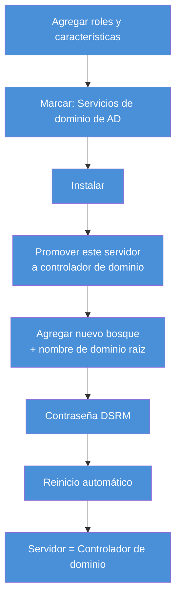

# Casos Prácticos — Tema 5. Administración de SO de servidor propietario

---

## Caso Práctico 1  — "Creación de los usuarios de una oficina"

**Planteamiento:** los usuarios y grupos locales son aquellos creados en un equipo, cuyo límite es ese mismo equipo. Para una oficina con una sola sede física, se deben dar de alta varios usuarios.

**Nudo:** crear cuatro usuarios: `UsuarioAdministrativo`, `UsuarioRecepcionista`, `UsuarioContable` y `UsuarioFinanciero`. Además, crear un grupo `Administración` que incluya a `UsuarioContable` y `UsuarioFinanciero`.

**Desenlace (resuelto):**

1. Clic derecho en el botón de Inicio → **Administración de equipos**.
2. `Herramientas del sistema → Usuarios y grupos locales → Usuarios`.
3. Menú `Acción → Usuario nuevo` → crear los cuatro usuarios, uno a uno, con nombre y contraseña.
4. Volver al árbol → `Grupos` → `Acción → Grupo nuevo` → nombre `Administración`.
5. Dentro del grupo nuevo, `Agregar` → escribir/buscar `UsuarioContable` y `UsuarioFinanciero` → `Aceptar`.

| Usuario creado | ¿En el grupo "Administración"? |
|---|---|
| UsuarioAdministrativo | No |
| UsuarioRecepcionista | No |
| UsuarioContable | ✅ Sí |
| UsuarioFinanciero | ✅ Sí |

> 💡 Esto es exactamente lo que vimos en el apartado 2 de los apuntes: los permisos se dan al grupo, no a cada usuario por separado — si mañana hay que dar un permiso nuevo a contabilidad y finanzas, se da **una vez** al grupo `Administración`, no dos veces.

---

## Caso Práctico 2 — "Instalación del Active Directory"

**Planteamiento:** Active Directory es el servicio de directorio de Windows: crea usuarios, equipos o grupos, y administra los inicios de sesión de los equipos conectados a la red.

**Nudo:** seguir los pasos para instalar y configurar AD, con dominio raíz `InformaticoMedac.actividad2`.

**Desenlace (resuelto):**

1. **Administrador del servidor → Agregar roles y características** → asistente → Siguiente.
2. "Instalación basada en roles o características" → Siguiente → elegir el servidor de destino → Siguiente.
3. En **Roles de servidor**, marcar **"Servicios de dominio de Active Directory"**.
4. Aparece un aviso pidiendo características adicionales (herramientas de administración remota del servidor, PowerShell de AD DS, etc.) → **Agregar características**.
5. Dejar las características por defecto → Siguiente → Siguiente (pantalla informativa de AD DS) → Siguiente.
6. **Confirmar selecciones** → **Instalar**. Al acabar → **Cerrar**.
7. Con el rol ya instalado, hay que **promover el servidor a controlador de dominio**: desde el aviso que aparece en el Administrador del servidor (icono de notificación) → "Promover este servidor a controlador de dominio".
8. Elegir **"Agregar un nuevo bosque"** (si es el primer controlador de dominio) → nombre de dominio raíz: `InformaticoMedac.actividad2`.
9. Establecer el nivel funcional del bosque/dominio (por defecto, el más reciente), contraseña del **Modo de restauración de servicios de directorio (DSRM)**, opciones de DNS (se instala junto con AD), nombre NetBIOS.
10. Confirmar rutas de la base de datos de AD, revisar el resumen → **Instalar**. El servidor se reinicia automáticamente al terminar.
11. Al reiniciar, el servidor ya es **controlador de dominio**: el login pedirá `DOMINIO\usuario`, y en el Administrador del servidor aparecerá la nueva herramienta "AD DS".

> ⚠️ **Diferencia importante:** instalar el *rol* (pasos 1-6) solo copia los archivos del servicio. **Promover el servidor** (pasos 7-11) es lo que de verdad crea el dominio y convierte la máquina en controlador de dominio — son dos fases distintas, y es fácil olvidarse de la segunda.

---

## Caso Práctico 3 — Crear una Unidad Organizativa y un usuario de dominio

Una vez el servidor es controlador de dominio, la gestión diaria de usuarios/grupos se hace desde **"Usuarios y equipos de Active Directory"** (no desde "Administración de equipos", que es solo para lo local):

1. `Herramientas → Usuarios y equipos de Active Directory`.
2. Clic derecho sobre el nombre del dominio → `Nuevo → Unidad organizativa` → nombre, por ejemplo `Alumnos`.
3. Clic derecho sobre la OU `Alumnos` → `Nuevo → Usuario` → nombre, nombre de inicio de sesión, contraseña.
4. El usuario creado así **ya es un usuario de red**: puede iniciar sesión desde cualquier equipo unido al dominio, no solo desde el controlador.

| | Usuario local (Tema 5, apartado 2) | Usuario de dominio (aquí) |
|---|---|---|
| Se crea en | Administración de equipos | Usuarios y equipos de Active Directory |
| Válido en | Solo ese equipo | Todo el dominio (y bosque) |
| Cuenta almacenada en | Base de datos SAM local | Active Directory |

> 💡 Las **Unidades Organizativas (OU)** son el equivalente a "carpetas" dentro del dominio: sirven para organizar usuarios, equipos y grupos por departamento, sede o cualquier criterio, y para aplicarles políticas (GPO) de forma diferenciada — aunque las políticas de grupo en sí se ven más adelante en el curso.
